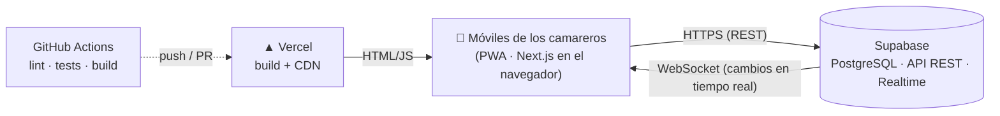

# Timbre TPV

[](https://github.com/M0r3n0SVQ/timbre-tpv-portfolio/actions/workflows/ci.yml)
[](./LICENSE)

TPV (terminal punto de venta) web para **Cervecería El Timbre**, pensado para que varios camareros trabajen a la vez desde el móvil, con sincronización en tiempo real entre dispositivos y una pantalla de cocina.

> **En producción en un negocio real** desde mayo de 2026, usado a diario en cada servicio.
> Este es el repositorio público del proyecto. El despliegue de producción vive en un repositorio privado para no exponer su infraestructura, configuración ni datos.

## Qué hace

- Cuentas simultáneas por mesa o cliente: añadir productos, juntar cuentas, renombrar, borrar.
- Cobro completo, parcial (por artículos o por importe), dividido entre N y cálculo de cambio; efectivo o tarjeta con desglose de caja.
- Turnos de mañana y tarde compartidos entre dispositivos, con historial de cobros y ticket.
- Pantalla de cocina con los platos pendientes en orden de llegada.
- Lista de la compra compartida.
- PWA instalable en iOS y Android.

## Arquitectura



- **Sin backend propio:** el navegador habla directamente con Supabase mediante `@supabase/supabase-js`.
- **Sincronización en dos capas:** Supabase Realtime para cambios inmediatos y polling de respaldo para garantizar que todos los dispositivos convergen.
- **Despliegue continuo:** cada push a `main` pasa por CI y Vercel lo despliega automáticamente.

Documentación técnica completa (esquema, decisiones de diseño, seguridad e incidentes): **[ARCHITECTURE.md](./ARCHITECTURE.md)**.

## Stack

Next.js 16 · React 19 · TypeScript · Tailwind CSS 4 · Supabase (PostgreSQL) · Vitest · GitHub Actions · Vercel

## Estructura

```
app/                  Interfaz (Next.js App Router): página única, layout PWA y manifest
components/           Componentes reutilizables (BottomSheet, NumPad)
hooks/                Un hook por dominio: cuentas, cobros, sesión, cocina
lib/                  Lógica pura y testeada + cliente de Supabase
supabase/schema.sql   Esquema de la base de datos
supabase/migrations/  Migraciones, cada una documentada
.github/workflows/    CI, backup diario y prueba de restauración
scripts/backup/       Backup, restauración y verificación (los usan los workflows y el runbook)
docs/                 Runbooks y operación: RLS, backups, monitorización
```

## Ejecutar en local

Requisitos: Node.js 20+ y un proyecto de Supabase (el plan gratuito sirve).

1. En Supabase:
   - SQL Editor: ejecuta [`supabase/schema.sql`](./supabase/schema.sql).
   - Authentication → Users → *Add user*: crea la cuenta del bar.
   - Authentication → Sign In / Providers: desactiva *Allow new users to sign up*.
2. Copia las variables de entorno y rellénalas con los datos de tu proyecto:

   ```bash
   cp .env.example .env.local
   ```

3. Instala y arranca:

   ```bash
   npm install
   npm run dev
   ```

4. Abre <http://localhost:3000>.

### Variables de entorno

| Variable | Descripción | ¿Secreta? |
|---|---|---|
| `NEXT_PUBLIC_SUPABASE_URL` | URL del proyecto de Supabase | No |
| `NEXT_PUBLIC_SUPABASE_PUBLISHABLE_KEY` | Clave pública (*publishable* / `anon`) | No: va en el bundle del navegador por diseño; la protección la dan las políticas RLS |
| `NEXT_PUBLIC_TPV_EMAIL` | Email de la cuenta del bar; la pantalla de login solo pide la contraseña | No |

Nunca se usa la clave `service_role` ni la contraseña de la base de datos en el frontend.

### Scripts

| Comando | Qué hace |
|---|---|
| `npm run dev` | Servidor de desarrollo |
| `npm run build` | Build de producción (incluye chequeo de tipos) |
| `npm run lint` | ESLint |
| `npm test` | Tests con Vitest |

## Calidad y operaciones

- **CI:** GitHub Actions ejecuta auditoría de dependencias, lint, tests y build en cada push y pull request. Una vulnerabilidad alta o crítica en dependencias de producción bloquea el pipeline.
- **Backups:** volcado diario cifrado de la base de datos con GitHub Actions y **prueba de restauración automática semanal** en un PostgreSQL vacío, que comprueba tablas, número de filas y RLS. Ver [docs/backups.md](./docs/backups.md).
- **Monitorización:** endpoint `/api/health` que comprueba que Supabase responde y que la base de datos sigue protegida, vigilado cada 5 minutos con UptimeRobot; los backups avisan a Healthchecks.io, que alerta si fallan o si no llegan a ejecutarse. Ver [docs/monitorizacion.md](./docs/monitorizacion.md).
- **Dependencias:** Dependabot propone cada semana las actualizaciones (npm y GitHub Actions) como PRs que valida el CI.
- **Tests:** la lógica crítica (identidad de platos, cálculo de cocina) está extraída a `lib/` y cubierta con tests, a raíz de un [incidente real en producción](./ARCHITECTURE.md#incidente-platos-homónimos-entre-categorías).
- **Seguridad:** autenticación de Supabase y Row Level Security en todas las tablas; sin sesión, la clave pública no da acceso a ningún dato. Una sola contraseña por dispositivo, que se queda guardada y se renueva sola para no interrumpir el servicio.

### Roadmap

- [x] Autenticación y Row Level Security en todas las tablas
- [x] Backups automáticos de la base de datos con restauración probada
- [x] Monitorización de disponibilidad con alertas
- [ ] Seguimiento de errores del navegador (Sentry)
- [ ] Runbook de incidencias

## Sobre el desarrollo

Diseñado, desarrollado y mantenido por Álvaro Moreno, con asistencia de IA (Claude Code) para la implementación. Los requisitos, las decisiones de arquitectura y la validación en producción son míos.

## Licencia

[MIT](./LICENSE). El nombre y el logotipo de Cervecería El Timbre (`public/logo.jpg` y los iconos de la app) pertenecen al establecimiento y no están cubiertos por la licencia.
